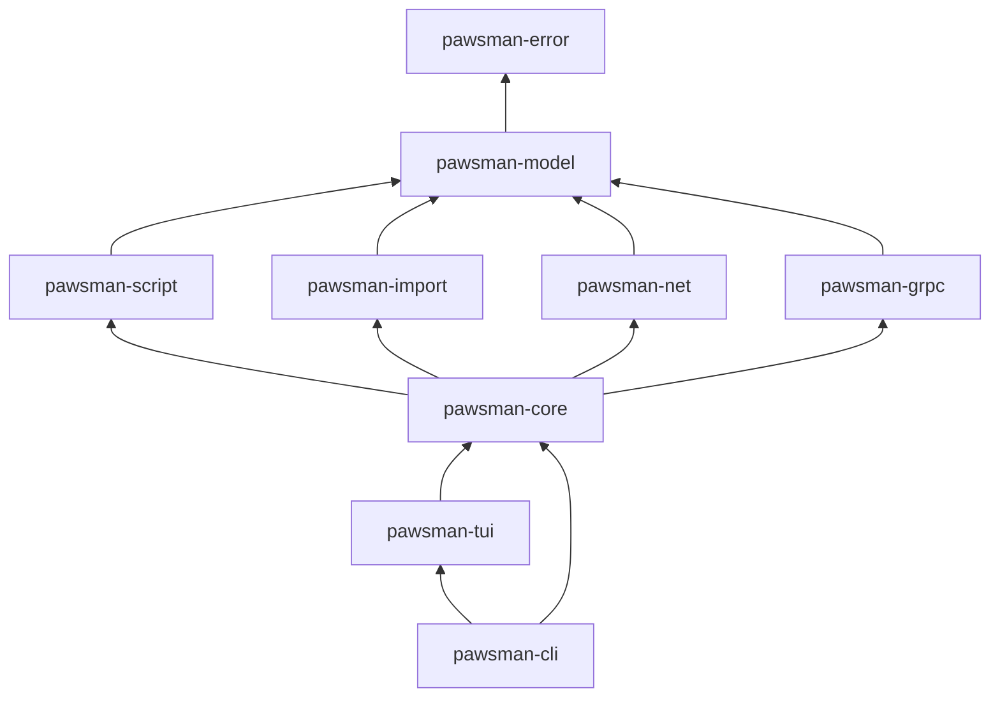
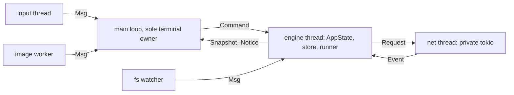
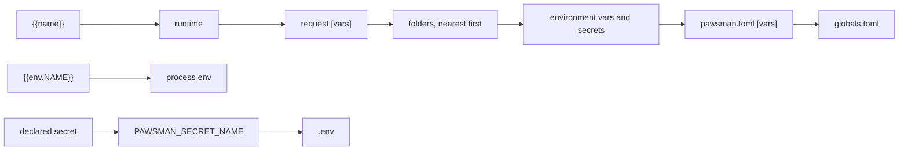

# Architecture

How pawsman is put together. The full design and its rationale: [program spec](superpowers/specs/2026-10-23-pawsman-design.md).

## 1. Crates

| Crate | Role |
| --- | --- |
| `pawsman-error` | `ErrorInfo`, `ErrorCode`, `Retry` |
| `pawsman-model` | Pure domain: collection tree, requests, environments, scopes, interpolation, TOML format |
| `pawsman-script` | Declarative captures and assertions; sandboxed Rhai |
| `pawsman-import` | Bruno, Postman, OpenAPI and cURL converters; cURL export |
| `pawsman-net` | HTTP, SSE, WebSocket, GraphQL on a private tokio runtime thread |
| `pawsman-grpc` | Dynamic gRPC |
| `pawsman-core` | Engine: reducer, store and watcher, secrets, history, runner, keys, settings |
| `pawsman-tui` | Terminal, probe, graphics, views, input |
| `pawsman-cli` | Binary `pawsman`: TUI, `pawsman run`, `pawsman mock` |
| `pawsman-test-support` | Fakes and fixtures |

Later: `pawsman-mock` (M6), `pawsman-git` and `pawsman-ai` (M7).

## 2. Threads

## 3. Collection layout

A collection is a directory: `pawsman.toml` (format version, defaults), `envs/*.env.toml`, folders with optional `_folder.toml` and one `*.req.toml` per request, sidecar bodies, a git-ignored `.env` and `.pawsman/` for local state. Details: [spec §2](superpowers/specs/2026-10-23-pawsman-design.md#2-on-disk-format-variables-and-secrets).

## 4. Variable scopes

Highest wins: runtime, request, folder chain (nearest first), environment, collection, global, then process env through `{{env.NAME}}` only. Secrets resolve from process env, `.env`, the OS keyring, then the age vault (keyring and vault from M3).

`pawsman_model::interpolate` is pure: core builds the `Scopes` (`pawsman_core::resolve`), the model returns the resolved request, a trace of each value's scope, and a `Redactor` that hides every secret and `env.*` value it used in logs, errors and on screen.
