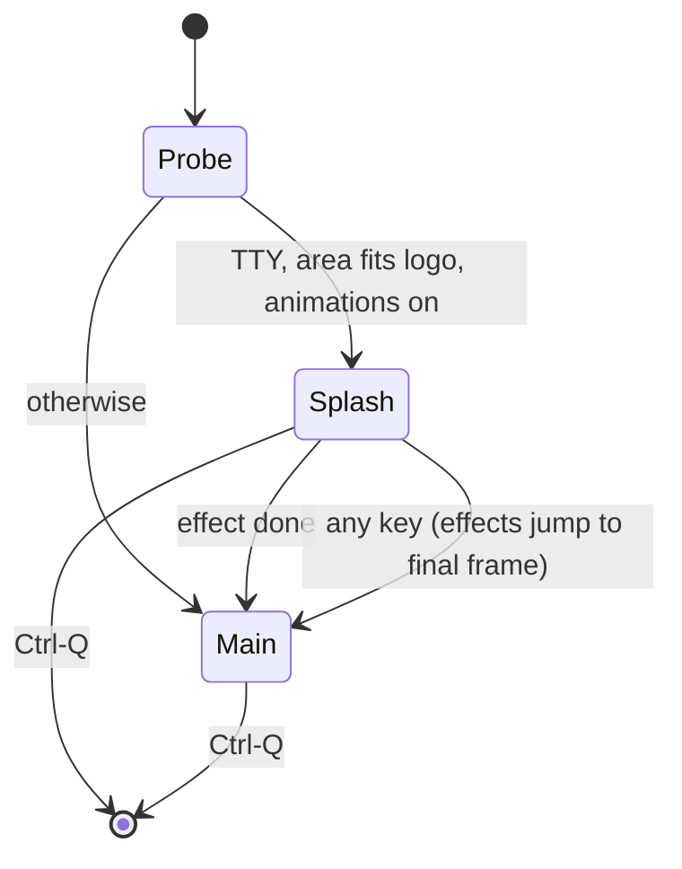

# Startup animation

How ratatui projects animate a splash, and what pawsman uses. Versions and licences checked on crates.io on 2026-10-23.

## Decision

Cell-based animation with [tachyonfx](https://github.com/ratatui/tachyonfx), about 1.2 s, any key skips, drawing stops when the effect is done. A kitty image logo, when used, is transmitted once and shown static; kitty's own frame animation is not used.

## Crates

| Crate | Version | Licence | Use |
| --- | --- | --- | --- |
| tachyonfx | 0.25.2 | MIT | Effects over a ratatui `Buffer`: `coalesce`, `fade_from_fg`, `hsl_shift_fg`, `sweep_in`, combinators, spatial patterns, easings. `default-features = false, features = ["std"]` drops the DSL parser |
| tui-big-text | 0.8.10 | MIT OR Apache-2.0 | Optional wordmark; a hand-made `const` logo needs no dependency |
| ratatui-image | 11.1.0 | MIT | Optional static kitty logo. Uses `t=d` with Unicode placeholders and tmux passthrough. `default-features = false, features = ["crossterm"]`: the default `chafa-dyn` links LGPL libchafa |

Rejected: cfonts (GPL-3.0), tui-rain (ratatui 0.29 only), ratatui-splash-screen (sleep-driven loop).

## Reference projects

| Project | Technique | Worth reusing |
| --- | --- | --- |
| [maki](https://github.com/tontinton/maki) `maki-ui/src/splash.rs` | Hand-rolled ease-out fade and sine-wave field | Render is a pure function of `start.elapsed()`; the widget reports a cadence (16 ms while animating, idle after), so the loop goes back to blocking reads |
| [glim](https://github.com/junkdog/glim) | tachyonfx `parallel`/`sequence` of fades, coalesce and sweeps scoped by `CellFilter` | Skip by processing effects with a one-hour delta: every effect jumps to its final frame |
| [splashboard](https://github.com/unhappychoice/splashboard) | tachyonfx 0.25, ratatui 0.30, ratatui-image without chafa | Frame as a function of the timestamp, tested through `TestBackend` |

## Kitty frame animation vs cells

- Kitty supports terminal-side animation (`a=f` frames, `a=a` playback), and its spec recommends that over client-driven redraws for SSH latency.
- Every frame must be uploaded before playback: estimated hundreds of KB to several MB for a short logo reveal, which can arrive after the user has pressed a key.
- Cell animation sends only changed cells (estimated under 8 KB per frame for a 40×8 logo) and behaves the same in kitty, sixel and half-block terminals, in tmux and in `TestBackend`.
- Not verified: `a=f`/`a=a` support in Ghostty, WezTerm and Konsole; animation of virtual placements (`U=1`); tmux relaying frame commands.

## Design

- The effect: the logo coalesces in, fades up from the background, then a hue sweep crosses it; the tagline sweeps in; a short fade hands off to the main view.
- While the effect runs the loop polls every 16 ms and draws; after it ends the loop blocks on input (no idle redraws).
- The splash never waits on startup work; collections load behind it.
- Off by `--no-splash`, `ui.animations = false` or `PAWSMAN_NO_ANIMATION`, read through the env snapshot.
- Without truecolor, RGB cells map to indexed colours after processing; on 16 colours or `TERM=dumb` the final frame shows once.
- Random effects take a seeded RNG (`SimpleRng::new(seed)`), so frames are deterministic.

## Testing

- insta snapshots of `TestBackend` buffers at 0, 300, 600, 900 and 1200 ms with a fixed seed.
- Skip test: after a key, the effect is done and the next frame equals the final snapshot.
- Cadence test: once done, the loop has no pending timer.
- 256-colour test: no `Color::Rgb` remains.
- Visual PNG files reviewed before merge.

## Prototype findings

From the M0 PoC (`pawsman-poc/splash`, tachyonfx 0.25.2, ratatui 0.30.2) in kitty 0.49.2.

| Measure | Result |
| --- | --- |
| Effect | `parallel`: `coalesce` (500 ms, QuadOut, seeded, `CellFilter::Text`), `fade_from_fg(BG)` (750 ms, CubicOut, from 0 ms), `delay(550, ping_pong(hsl_shift_fg([40, 0, 12], 300 ms, SineInOut)))`; done at about 1.17 s |
| Live run | 59 frames in 1.21 s, then no redraw until input |
| Bytes | 270 KB for the whole run (about 4.6 KB per frame for a 44×5 logo); the first version, with effects over the whole screen, wrote 20 KB per frame |
| Skip | a key mid-animation jumps to the final frame (`(skipped)` at 1.10 s) |
| 256 colours | readable gradient through the xterm-256 cube; no `Color::Rgb` left |

Rules for M1 that came out of it:

- **Advance in ticks, apply once.** `sequence` and `delay` move one stage per `process` call, so a long delta stalls them; and each call blends with what is already in the buffer, so ticks applied to the same buffer compound (a fade restarts from its own output, a lightness shift runs to white). Step every tick but the last on a scratch copy of the freshly painted buffer, then apply the last tick to the real one.
- **Confine effects to the logo's rectangle**: effects over the whole area recolour blank cells and multiply the bytes per frame.
- **A resize redraws, never skips**: a tiling window manager resizes a new window right after start.
- **No sleep before the fade**: the logo must start at the background colour, or it flashes.
- **The hue sweep returns to the base colours** (`ping_pong`), so the last animated frame equals the static logo.
- Over SSH, halve the frame rate (about 30 fps) to halve the bytes; the effect is time-based, so it keeps its length.
