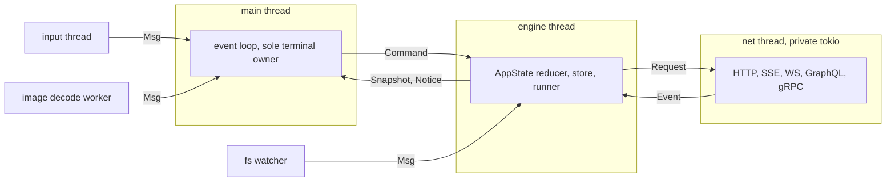
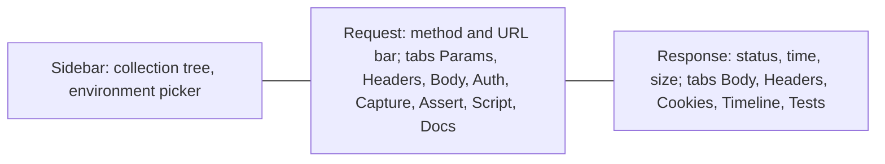

# pawsman: program design

Status: approved.

## Goal

A pure-Rust terminal API client inspired by [Bruno](https://github.com/usebruno/bruno): offline, file-based, git-friendly collections, driven from a ratatui TUI. No JavaScript, no wasm. Kitty protocols (graphics, keyboard, OSC 52 clipboard) are first-class, and everything works over SSH and inside tmux.

## What the user chose

| Topic | Choice |
| --- | --- |
| Bruno compatibility | Inspired remake: own on-disk format; Bruno collections are an import source only |
| Scripting | Declarative captures and assertions, Rhai as the escape hatch |
| Protocols | HTTP, GraphQL, WebSocket, gRPC, SSE |
| Non-kitty terminals | Kitty-first; degrade by probed capability, never crash |
| Importers | Bruno, Postman v2.1, OpenAPI 3 / Swagger 2, cURL (plus cURL export) |
| Extras | Auth, cookies and proxy; collection runner with headless CLI; mock server and OpenAPI drift; git and AI |
| File syntax | TOML, one request per file, folders are directories |
| Secrets | Layered: env and `.env`, then OS keyring, then an age-encrypted vault |
| Architecture | Sync main loop, engine thread, private tokio runtime thread (b24 model) |
| Quit key | Ctrl-Q; Ctrl-C and Ctrl-V are copy and paste |
| Startup | A short, skippable startup animation, shipped as early as possible |

## Constraints that shaped the design

- Conventions follow `semoxide` and `b24-experiment`: their rules are copied into `rules/` and win every conflict.
- Over SSH there is no local filesystem, shared memory, clipboard daemon, browser or desktop keyring on the user's side; every feature needs an in-band path.
- The Bruno feature inventory comes from `rea` static analysis of the Bruno source ([docs/re/bruno-feature-inventory.md](../../re/bruno-feature-inventory.md)).

## 1. Crates and threading

Crates are split along purity and heavy dependencies; `tools/check-deps.sh` and `deny.toml` wrappers enforce the boundaries.

| Crate | Role | Key deps |
| --- | --- | --- |
| `pawsman-error` | `ErrorInfo` trait, `ErrorCode`, `Retry` | none |
| `pawsman-model` | Pure domain: collection tree, requests, environments, variable scopes, interpolation, TOML format and migrations, newtype ids | serde, toml |
| `pawsman-script` | Declarative captures and assertions (JSONPath, regex, header, status); sandboxed Rhai (operation, memory and time limits) | rhai, serde_json_path |
| `pawsman-import` | Pure converters: Bruno, Postman, OpenAPI, cURL into the model; cURL export | serde_json, openapiv3 |
| `pawsman-net` | Owns tokio on a private runtime thread; HTTP, SSE, WebSocket, GraphQL introspection; no public `async fn` | tokio, reqwest (rustls), tokio-tungstenite |
| `pawsman-grpc` | Dynamic gRPC via server reflection or `.proto` files | tonic, prost-reflect |
| `pawsman-core` | Engine: session, `AppState::apply` reducer, store and watcher, secrets, history, runner, key table, settings; no terminal deps | notify, secrecy, keyring, age |
| `pawsman-tui` | `term` module (probe, mode stack, graphics, OSC 52), views, input | ratatui, crossterm, unicode-width, image |
| `pawsman-cli` | Binary `pawsman`: TUI by default, `pawsman run` headless runner, later `pawsman mock` | clap |
| `pawsman-test-support` | Fakes and fixtures (`publish = false`) | wiremock |

Later milestones add `pawsman-mock` (axum, M6), `pawsman-git` (gix, M7) and `pawsman-ai` (Claude API over reqwest, M7). Each milestone spec lists its dependencies for approval before they are added.



- Only the main loop writes to the terminal; other threads send messages.
- No work outlives its owner: cancellation tokens and joined threads on shutdown.
- `pawsman run` drives `pawsman-core` directly, without the TUI.
- A daemon and thin-client split (detach and reattach over SSH) stays possible because the engine already talks through `Command` and `Event`; it is out of scope.

## 2. On-disk format, variables and secrets

### Collection layout

```text
my-api/
  pawsman.toml              collection: format version, name, defaults
  envs/dev.env.toml         non-secret vars; secrets declared by name only
  users/_folder.toml        optional folder defaults and request order
  users/get-user.req.toml   one request
  users/create-user.body.json  optional sidecar body
  .env                      git-ignored secret values
  .pawsman/                 git-ignored local state: history, cookies, UI state
```

### Request file

```toml
name = "Get user"
kind = "http"               # http | graphql | ws | grpc | sse
method = "GET"
url = "{{base}}/users/{{id}}"

[headers]
Accept = "application/json"

[[capture]]
var = "etag"
from = "header:ETag"

[[assert]]
expr = "status == 200"

[script]
post = """
if res.json.admin { vars.role = "admin" }
"""
```

- Sections: `headers`, `query`, `body`, `auth`, `capture`, `assert`, `script` (`pre`, `post`), `docs`.
- `[body]` holds exactly one of `json`, `text`, `form`, `multipart` (parts may reference files) or `file`.
- Bodies above a line threshold, and binary bodies, move to a sidecar file so diffs stay readable.
- Order lives in `_folder.toml` (`order = [...]`), so renaming never reorders.
- `pawsman.toml` carries `format = 1`; `pawsman-model` owns migrations between format versions.
- Unknown keys are an error, not silently dropped.

### Variable resolution

Highest scope wins:

1. Runtime: captures and script assignments (session-only unless persisted explicitly)
2. Request
3. Folder chain, nearest first
4. Environment
5. Collection
6. Global (`~/.config/pawsman/globals.toml`)
7. Process environment, only through `{{env.NAME}}`, read from the env snapshot

Built-ins: `{{$uuid}}`, `{{$timestamp}}`, `{{$isoDate}}`, `{{$randomInt}}`.

Interpolation is a pure function returning the resolved request plus a trace of each variable's source scope; the TUI shows the trace on demand. An unknown variable is a typed error, never an empty string.

### Secrets

- Environments declare secret names: `secrets = ["token", "client_secret"]`. Values never appear in collection files.
- Resolution order: process env (`PAWSMAN_SECRET_<NAME>`), then `.env`, then the OS keyring when reachable, then the age-encrypted vault (`~/.local/share/pawsman/vault.age`, passphrase once per session).
- Values are `secrecy::SecretString`: masked in the TUI until revealed, redacted in logs, history and cURL export (unless the user picks "include secrets").
- OAuth2 tokens use the same store.

### History and local state

- History is append-only JSONL under `.pawsman/history/`: request snapshot (secrets redacted), response metadata and body up to a size cap, truncated with a marker beyond it.
- The cookie jar is per collection, under `.pawsman/`.
- pawsman adds `.env` and `.pawsman/` to the collection's `.gitignore` on creation.

## 3. TUI, terminal capabilities and input

### Layout



- Below about 160 columns request and response stack vertically; below about 80 only the focused pane shows.
- Response body views: JSON pretty-printed, highlighted, collapsible, with a JSONPath filter line; XML and HTML pretty text; images through the graphics path; binary as hex; SSE and WebSocket as a live message stream.
- Timeline: DNS, connect, TLS, time to first byte, redirect chain.

### Editing

- Single-line fields use an in-app line editor; bodies and scripts use an embedded multi-line editor with JSON and Rhai highlighting.
- `Ctrl-E` opens `$EDITOR` on the body or the whole request file: every terminal mode is undone, then restored.
- The store watcher picks up external edits.

### Capability probe

One probe before the input thread starts, with a timeout, produces a `Caps` value. Views branch on `Caps`, never on `$TERM`.

| Capability | Probe | Fallback |
| --- | --- | --- |
| Kitty graphics | `ESC _G i=…;a=q` query, DA1 as terminator | sixel (DA1 attribute 4), then half blocks, then a text placeholder `[image 640×480 png]` |
| Kitty keyboard | `CSI ? u` | Legacy keys; ambiguous bindings get alternatives |
| OSC 52 clipboard | Write assumed; read only on user request | arboard on local sessions, else a notice that the copy may not have landed |
| Colour depth | `COLORTERM` from the env snapshot, DECRQSS | 256, then 16 colours |
| tmux | `TMUX` | Graphics and OSC 52 wrapped in DCS passthrough; hint to enable `allow-passthrough` |
| SSH | `SSH_TTY`, `SSH_CONNECTION` | Disable local-only paths: arboard, file and shared-memory image transmission, browser launch (show the URL and copy it via OSC 52) |

### Images

- Direct transmission (`t=d`, chunked base64) with Unicode placeholders (`U=1`): images scroll and clip as ordinary cells, survive SSH, and pass through tmux.
- Every image has an id and is deleted when it leaves the screen and on exit.
- Decode and scale on a worker thread, sized from the cell geometry (`CSI 16 t`); the layout reserves the final size so nothing jumps.

### Keys

- One key table generates the hint bar and the F1 help overlay; user overrides in `~/.config/pawsman/keys.toml`.
- Ctrl-Q quits. Ctrl-C copies the selection (no-op with a hint when nothing is selected); Ctrl-V pastes; pasted text arrives through bracketed paste.
- Raw mode disables XON/XOFF so Ctrl-Q reaches the app in legacy terminals.
- Esc steps back one level. Typed characters are never commands while a text field has focus.
- Ctrl-Enter sends; Alt-Enter is the legacy-terminal alternative.
- Ctrl-K opens the command palette: fuzzy search over requests and actions.
- Mouse: click to focus, scroll, drag pane borders.

### Startup animation

- A splash of about 1.2 s plays once the probe finishes and before the main view; any key skips it, and Ctrl-Q still quits.
- Cell-based tachyonfx effects (coalesce, fade, hue sweep), so it costs a few kilobytes per frame over SSH; with kitty graphics a static logo image may join in, never animated through the protocol.
- Frames are drawn only while the animation runs, then redraws stop (no idle redraws).
- Falls back to fewer colours by `Caps`; `--no-splash`, `ui.animations = false` in settings and `PAWSMAN_NO_ANIMATION` turn it off.
- Tested with `TestBackend` snapshots at fixed timestamps plus visual PNG files.
- Technique and crates come from the splash research ([docs/research/startup-animation.md](../../research/startup-animation.md)).

### Terminal modes

Every mode the app enables (alternate screen, raw mode, kitty keyboard flags, mouse, bracketed paste, focus events) is listed in `term::MODES` and undone newest-first on exit, on error, in `Drop` and in the panic hook.

## 4. Errors, observability, testing and tooling

### Errors

- One typed error per crate: a public struct over a private `Kind` enum, implementing `ErrorInfo` (`code`, `help`, `retry`). No `anyhow`.
- Namespaced codes (`net::tls_handshake`, `model::unknown_var`) with a registry test and one page per code under `docs/errors/<ns>/<slug>.md`.
- Rendered only at the edges: TUI notices and status line, `pawsman run` report and exit code.
- Wording: lowercase, one line, no trailing punctuation, no "failed to" prefix; help is one imperative sentence.

### Observability

- Libraries emit `tracing` events only; the binary installs a daily rolling file log under `~/.local/state/pawsman/`, never on the terminal.
- `PAWSMAN_LOG`, falling back to `RUST_LOG`.
- `url_for_log()` strips credentials and secret query values.

### Testing

- Tests first: a `test:` commit failing on assertions, approval, then `feat:` or `fix:`.
- nextest; insta for format round trips and rendered buffers; proptest for interpolation, TOML round trips and the cURL parser; rstest for tables.
- Fakes, not mocks: wiremock for HTTP; WebSocket, SSE and gRPC fake servers in `pawsman-test-support`. Fake secrets carry the `PAWSMAN_FAKE` marker.
- `#[tokio::test(start_paused = true)]` for timing.
- `TestBackend` assertions plus visual PNG checks (`target/visual/*.png`) for UI changes.
- PTY tests replay canned terminal responses to cover each probe and fallback path, including Ctrl-Q in a legacy terminal.
- cargo-mutants on the diff; fuzz targets for the cURL, Postman and Bruno parsers.

### Tooling

Copied from semoxide, renamed: workspace lints, `clippy.toml`, `rustfmt.toml`, `rust-toolchain.toml` (1.99.0, MSRV 1.97), `deny.toml` with crate-boundary wrappers, `lefthook.yml`, `mise.toml`, renovate, GitHub Actions CI (quality, deny, Linux and macOS test matrix, msrv, required-checks), `tools/check-deps.sh`. Licence MIT OR Apache-2.0.

`rules/` adapts b24's: `rust-project.md`, `tui.md` (with the Ctrl-Q change) and a new `rust-api-client.md`.

## 5. Milestones

Each milestone gets its own spec and plan when it starts, tracked as a GitHub milestone with issues.

| Milestone | Delivers | Exit check |
| --- | --- | --- |
| M0 Foundations | Tooling, docs, rules; Bruno inventory; PoCs (separate scratch repo) for kitty images over SSH and tmux, keyboard protocol, OSC 52, Rhai limits | Every PoC demonstrated in kitty over `ssh localhost` and in tmux |
| M1 HTTP client | Startup animation first (the earliest shippable slice), then model and format, environments and variables, store and watcher, three-pane TUI, request editing and `$EDITOR`, response viewer (JSON, images, hex), timeline, history, cURL import and export, command palette | Edit and send requests against a wiremock fake in the TUI; visual PNG files reviewed |
| M2 Tests and runner | Captures, assertions, Rhai sandbox, request chaining, collection runner, `pawsman run` with JUnit and JSON reports | Runner passes a fixture collection in CI |
| M3 Auth and network | Basic, Bearer, Digest, AWS SigV4, NTLM; OAuth2 (auth code with PKCE over a loopback redirect, client credentials, refresh); cookies; HTTP, SOCKS and PAC proxies; mTLS; layered secrets and vault | OAuth2 auth-code flow completes over SSH with the URL copied through OSC 52 |
| M4 Protocols | GraphQL (editor, variables, introspection, docs explorer), SSE, WebSocket, gRPC (reflection and `.proto`, unary and all streaming modes) | Each protocol works against a fake in the TUI |
| M5 Importers | Bruno, Postman v2.1, OpenAPI 3 and Swagger 2 | Bruno's own test collections import, with any loss reported |
| M6 Mock and drift | `pawsman mock` from saved examples or a spec; OpenAPI drift detection and sync | Mock serves an imported spec; drift is shown in the TUI |
| M7 Git and AI | Git status, diff, commit, pull, push (gix); AI request and Rhai generation via the Claude API (`claude-opus-5-5` default, configurable) | End-to-end demo |

## Out of scope

- Reading or writing Bruno files as a native format.
- JavaScript execution of any kind, including imported Bruno scripts (imported as commented-out Rhai stubs).
- A GUI frontend; a daemon and client split.
- Bruno features absent from the choices above: embedded terminal, workspace-level docs editor, system resource monitor.
