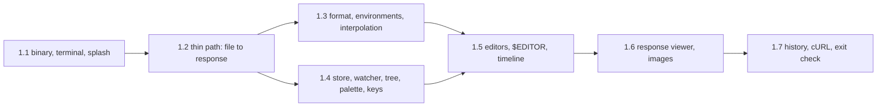

# M1 HTTP client: milestone design

Status: draft, for review.

Delivers the M1 row of the [program spec §5](2026-10-23-pawsman-design.md#5-milestones): a `pawsman` binary that opens a collection, edits and sends HTTP requests, and shows the response, in kitty, over SSH and inside tmux. Issues #10–#20 and #42.

## Intent

| Said by the user | Taken from it |
| --- | --- |
| Pure Rust, ratatui, kitty-first, works over SSH | Every piece is checked in kitty, over SSH and in tmux (the Docker matrix from M0) |
| A beautiful startup animation, as early as possible | Piece 1.1 ships the binary with the splash before any API-client feature |
| M1 exit: edit and send requests against a fake server in the TUI, visuals reviewed | Piece 1.7 ends on that check, automated in a PTY test and done once by hand |

Assumed: HTTP only (GraphQL, WebSocket, SSE and gRPC are M4); no scripts, captures or assertions (M2); no auth helpers, cookies or proxies (M3); secrets resolve from the process env and `.env` only (keyring and vault are M3).

## Pieces

Splash first, then the thinnest end-to-end path, then widen. Each piece has its own plan and lands green on `main`.

| Piece | Issues | Crates touched |
| --- | --- | --- |
| 1.1 | #10, #14 (no images), #42 | `pawsman-tui`, `pawsman-core` (env snapshot, paths, settings), `pawsman-cli` |
| 1.2 | #11, #15, #17 (first cut of each) | `pawsman-model`, `pawsman-net`, `pawsman-core`, `pawsman-tui`, `pawsman-test-support` |
| 1.3 | #11, #12 | `pawsman-model` |
| 1.4 | #13, #15 | `pawsman-core`, `pawsman-tui` |
| 1.5 | #16, #17 | `pawsman-tui`, `pawsman-net` |
| 1.6 | #18, #14 (images) | `pawsman-tui`, `pawsman-script` (JSONPath only) |
| 1.7 | #19, #20 | `pawsman-core`, `pawsman-import` |

## Cross-cutting decisions

- **pawsman decodes input itself.** The input thread reads `/dev/tty` with `rustix::event::poll` and feeds bytes to a pure, stateful `input::Decoder` (legacy keys, kitty `CSI … u` under DISAMBIGUATE, SGR mouse 1006, bracketed paste, focus, and probe-shaped replies, which it drops). crossterm can neither take bytes from pawsman nor drop a late `APC G` reply, which it would type as keys (issue #42). crossterm stays for raw mode, the ratatui backend and the OSC 52 encoder.
- **Signals through `signal-hook`.** SIGWINCH, SIGTERM, SIGHUP and SIGINT go to a self-pipe in the input thread's poll set. SIGWINCH becomes `Msg::Resize`; the others restore the terminal and exit, so an SSH drop leaves no broken modes.
- **Engine state is published as `Arc<Snapshot>`.** The engine thread applies each `Command` through `AppState::apply` and sends a fresh `Arc<Snapshot>` (bodies behind `Arc`) to the main loop. UI-only state (focus, scroll, cursors, selection) lives in `pawsman-tui`.
- **Edits are commands, saves are explicit.** Editing sends `Command::Edit`; the request shows a dirty mark until Ctrl-S writes it. Ctrl-Q with unsaved changes asks first.
- **Own HTTP stack on hyper.** `pawsman-net` uses hyper 1 and hyper-util with its own connector that times DNS, TCP connect and TLS separately (rustls with the `ring` provider and the platform verifier), follows redirects itself to record the chain, and decompresses gzip, deflate, brotli and zstd. reqwest cannot report connect and TLS separately. Proxies (M3) go into the same connector.
- **Paths from the env snapshot.** `~/.config/pawsman`, `~/.local/state/pawsman` and `~/.local/share/pawsman` follow `XDG_*` and fall back to `$HOME/…` on Linux and macOS alike, without a directories crate.
- **Settings file.** `~/.config/pawsman/settings.toml`: `[ui] animations`, `images`; `[http] timeout_ms`, `connect_timeout_ms`, `body_cap_bytes`. Unknown keys are an error shown as a notice; the defaults apply.
- **tmux UTF-8 from the locale.** Inside tmux, images are Off unless `LC_ALL`, `LC_CTYPE` or `LANG` (first set wins) names UTF-8; `--images` overrides. pawsman cannot spawn `tmux` to ask.
- **Errors per crate** with a docs page per code, as in [CODE-ARCHITECTURE §4](../../CODE-ARCHITECTURE.md#4-errors). Each piece's failure table names its codes.

## 1.1 Binary, terminal and splash

Scope:

- `pawsman-cli`: `pawsman [--no-splash] [--images auto|kitty|sixel|blocks|off]`, `--version` (the `DIR` argument comes with 1.2). Builds the env snapshot, installs the rolling file log and the panic hook, runs the TUI, prints one exit line after restore when there is an error.
- `pawsman-core`: `env::EnvSnapshot` (the one `std::env::vars_os` call, with an `#[expect]`), `paths`, `settings` (only `[ui]` is read in 1.1), and the first rows of the `keys` table (quit, help, close, copy) with the Cyrillic folding table, so Ctrl-Q quits on a Russian layout; the hint bar and F1 already read it.
- `pawsman-tui::term`: `Term` with `MODES`, raw mode through `rustix::termios` (saved and restored exactly), setup and `restore` newest first, `Drop` and the panic hook (`try_lock`, never blocks). `suspend`/`resume` come with `$EDITOR` in 1.5 and `copy` (OSC 52) with the first selection in 1.6.
- `pawsman-tui::term::probe`: the M0 probe plus #42: inside tmux, a second DA1 through passthrough ends it, with at most 500 ms after tmux's own DA1, and tmux's DA1 never decides sixel. Produces `Caps` (graphics, keyboard protocol, cell size, colour depth, tmux and its UTF-8, SSH). The keyboard capability comes from this probe only.
- `pawsman-tui::input`: decoder, input thread, signal pipe.
- `pawsman-tui::app`: the main loop (drain all queued messages, then one draw; a timer only while the splash runs) and a placeholder main view: the small wordmark, "no collection open", and a hint bar (`Ctrl-Q quit · F1 help`), both generated from the key table.
- `pawsman-tui::views::splash`: the PoC splash, ported with its rules (ticks on a scratch buffer, effects inside the logo rectangle, resize never skips, no splash below the logo size, indexed colours without truecolour, final frame once on 16 colours or `TERM=dumb`), turned off by `--no-splash`, `ui.animations = false` or `PAWSMAN_NO_ANIMATION`.

Out of scope: images, collections, requests.

| Failure | Code | Retry |
| --- | --- | --- |
| No terminal (`/dev/tty` cannot be opened) | `tui::no_tty` | permanent |
| Writing to the terminal fails | `tui::terminal_io` | permanent |
| The input thread stops | `tui::input_closed` | permanent |
| Neither `HOME` nor `XDG_*` set | `core::no_home` (notice; no log, no settings) | permanent |
| A required mode (raw, alternate screen) cannot be set | `tui::terminal_mode` | permanent |
| Probe timed out | none: default `Caps`, logged | – |
| Log directory not writable | none: the app runs without a log, a notice says so | – |
| `settings.toml` invalid | `core::settings_invalid` (notice; defaults apply) | permanent |

End-to-end check: `pawsman` in kitty, over SSH into the matrix box, in tmux there with and without passthrough, and in xterm: splash plays (or is skipped by a key), the placeholder view shows, Ctrl-Q returns a clean shell (`stty -a` unchanged, cursor keys legacy). A PTY test (pty-process plus vt100) replays canned probe replies for kitty, tmux, xterm and silence, sends Ctrl-Q in legacy mode and checks that a late `APC G` reply types nothing. Real typing of shifted keys under DISAMBIGUATE is checked by hand in kitty (#42).

## 1.2 Thin path

Scope:

- `pawsman-model`: `Collection` (a directory with `pawsman.toml` and flat `*.req.toml` files), `Request` (name, method, URL, headers, text body), TOML read with unknown keys refused. Interpolation is left out; `{{…}}` passes through unchanged and is reported.
- `pawsman-net`: `Net::start()` spawns the runtime thread and returns a sync handle; `send(RequestId, ResolvedRequest)` and `cancel(RequestId)`; `NetEvent::{Done, Failed, Cancelled}` through a callback; one connection per request over HTTP/1.1 (pooling and HTTP/2 come with the timeline in 1.5). Bodies stream into memory up to `body_cap_bytes` (default 16 MiB) and spill to a `tempfile` beyond it. Timeouts from settings (default 30 s total, 10 s connect).
- `pawsman-core`: engine thread, `Command`, `AppState::apply`, `Snapshot`, cancel-and-join on shutdown.
- `pawsman-tui`: three panes (sidebar list, request pane read-only, response pane with status, time, size and raw text body); focus with Tab and the mouse; F5, Ctrl-Enter and Alt-Enter send; Esc cancels a request in flight.
- `pawsman-test-support`: an own fake HTTP server (wiremock has no release within a year) and a `pawsman-fake` binary that serves the demo routes on a printed port, for manual and PTY runs; a fixture collection under `fixtures/demo`.

Out of scope: the full format, environments, editing, watcher, pretty bodies.

| Failure | Code | Retry |
| --- | --- | --- |
| Not a collection directory | `model::not_a_collection` | permanent |
| Request file invalid TOML or unknown key | `model::invalid_file` (error node, app keeps running) | permanent |
| Invalid URL or header | `net::invalid_request` | permanent |
| DNS failure | `net::dns` | retryable |
| Connection refused or reset | `net::connect` | retryable |
| TLS handshake or certificate | `net::tls` | permanent |
| Timeout | `net::timeout` | retryable |
| Cancelled | none: a `Cancelled` outcome, shown as such | – |
| Spill file cannot be written | `net::spill` | retryable |

End-to-end check: `pawsman fixtures/demo` against `pawsman-fake`: select a request, F5, the response appears; Esc mid-request against a delayed route cancels it; Ctrl-Q during a request joins every thread (no hang, checked in a PTY test with a timeout).

## 1.3 Format, environments and interpolation

Scope:

- The full request file of [program spec §2](2026-10-23-pawsman-design.md#request-file) except `capture`, `assert` and `script`, which parse and are kept but do nothing until M2: `headers`, `query`, `body` (`json`, `text`, `form`, `multipart`, `file`), `docs`, `auth` (parsed, applied in M3).
- Folders as directories, `_folder.toml` (defaults, `order`), sidecar bodies (`*.body.json` and friends) above 40 lines or when binary.
- `pawsman.toml` with `format = 1`. `format::migrate(table, from)` is the single entry point; `format = 1` is the only version, and a newer version is an error.
- Environments (`envs/*.env.toml`), the global file, `.env` parsing, secret names.
- `interpolate(request, scopes) -> (ResolvedRequest, Trace)`: `{{name}}`, `{{env.NAME}}`, built-ins `$uuid`, `$timestamp`, `$isoDate`, `$randomInt`; `\{{` is a literal. The trace records each variable's scope and span. Resolved requests carry the secret values they used (`SecretString`) so later redaction matches them.
- TUI: environment picker in the sidebar; the trace on demand in the request pane.
- Round trips are snapshot- and property-tested: parse, write, parse again equals; a written file is stable byte for byte.

| Failure | Code | Retry |
| --- | --- | --- |
| Unknown variable | `model::unknown_var` | permanent |
| Variable cycle (`a` uses `b` uses `a`) | `model::var_cycle` | permanent |
| Unterminated `{{` | `model::bad_template` | permanent |
| `format` newer than supported | `model::format_too_new` | permanent |
| Sidecar body missing | `model::missing_sidecar` | permanent |
| Secret declared but not set | `model::missing_secret` | permanent |

End-to-end check: the demo collection gains `envs/dev` and `envs/prod` and a secret in `.env`; switching environments changes the resolved URL, the trace names each scope, and the secret never appears in the log file (a test greps it for the `PAWSMAN_FAKE` value).

## 1.4 Store, watcher, tree, palette and keys

Scope:

- `pawsman-core::store`: loads the collection tree; writes atomically (`tempfile` in the same directory, then `persist`); creates collections with `pawsman init [DIR]` (writes `pawsman.toml`, `.gitignore` with `.env` and `.pawsman/`).
- `pawsman-core::watch`: `notify` with a debouncer; reloads changed files; ignores its own writes by content hash; a file that stops parsing becomes an error node.
- Tree: expand, collapse, new request or folder, rename (file and `name`), delete with confirmation, move up or down (rewrites `order`).
- `pawsman-core::keys`: every action in the table (action, keys, context, hint), `~/.config/pawsman/keys.toml` overrides. The hint bar and the F1 overlay are generated from it.
- Command palette (Ctrl-K): fuzzy search over requests and actions (`nucleo-matcher`).

| Failure | Code | Retry |
| --- | --- | --- |
| Write fails (permissions, disk full) | `core::write` | retryable |
| Read fails | `core::read` | retryable |
| Rename onto an existing file | `core::exists` | permanent |
| Watcher cannot start | `core::watch` (notice; manual reload key works) | permanent |
| `keys.toml` invalid or conflicting | `core::keys_invalid` (notice; defaults apply) | permanent |

End-to-end check: edit a request file in another terminal; the TUI shows the change within a second. Break its TOML; the node turns into an error with the message. Rename and reorder in the TUI; `git diff` shows only the expected lines.

## 1.5 Editors, `$EDITOR` and timeline

Scope:

- Line editor for single-line fields (method, URL, header and query rows, form fields): grapheme-aware cursor, word moves, selection, undo.
- Multi-line editor for bodies with JSON highlighting. Built on tui-textarea if a release supports ratatui 0.30 when the plan is written; otherwise pawsman's own on the line editor's text model.
- Tabs of the request pane: Params, Headers, Body, Auth (shows "M3"), Capture, Assert, Script (read-only until M2), Docs.
- Ctrl-E: `Term::suspend` and `resume` (input thread paused, every mode undone and set up again), `$VISUAL` or `$EDITOR` (else `vi`) on the body or the whole request file, `resume`, full redraw; the watcher reloads.
- Timeline: DNS, connect, TLS, time to first byte, download, each redirect hop; reused connections show as reused.

| Failure | Code | Retry |
| --- | --- | --- |
| Editor not found or exits non-zero | `tui::editor` | permanent |
| Edited file no longer parses | `model::invalid_file` (shown; the previous version stays in memory) | permanent |
| Redirect loop or more than 10 hops | `net::redirects` | permanent |

End-to-end check: edit URL, a header and a JSON body in the TUI, save, send; the fake asserts the received request. Ctrl-E into `vi` over SSH and back leaves the screen and keys intact. The timeline of a request to an HTTPS fake shows four phases.

## 1.6 Response viewer

Scope:

- Body tab: JSON pretty-printed, highlighted, foldable, with a JSONPath filter line (`serde_json_path`, in a new `pawsman-script` crate that M2 extends); XML and HTML re-indented text; plain text; binary as hex; virtual scrolling so a 16 MiB body stays responsive.
- Images (PNG, JPEG, GIF first frame, WebP): decoded and scaled on the image worker. Kitty through pawsman's own encoder (`term::graphics`: PNG or zlib RGBA, whichever is smaller, 4096-byte chunks, `q=2`, Unicode placeholders, delete on leave and on exit); sixel through ratatui-image without its probe; half blocks; text placeholder when Off.
- Headers tab; Timeline tab (from 1.5).
- `Term::copy` (OSC 52, DCS-wrapped in tmux). Selection by keyboard and mouse; Ctrl-C copies it; "copy body" in the palette. Copies above 1 MiB ask first.

| Failure | Code | Retry |
| --- | --- | --- |
| JSON declared but invalid | none: shown as text with a notice | – |
| Invalid JSONPath | `script::jsonpath` | permanent |
| Image undecodable or above the pixel limit | none: the text placeholder names the reason | – |
| Image worker panic | none: caught per job, placeholder shown, logged | – |

End-to-end check: the fake serves JSON, an image, XML and binary; each renders in kitty, over SSH, in tmux with passthrough, and in xterm (sixel); visual PNG files reviewed. A copied JSONPath result reaches the desktop clipboard over SSH.

## 1.7 History, cURL and the exit check

Scope:

- History: append-only JSONL at `.pawsman/history/YYYY-MM-DD.jsonl`; request snapshot with secrets redacted, response metadata, body up to 256 KiB with a truncation marker. A history overlay lists entries per request; an entry opens read-only and can be re-sent.
- `pawsman-import::curl`: parse a cURL command (`-X`, `-H`, `-d`, `--data-raw`, `--data-binary`, `--json`, `-F`, `-u`, `-G`, `-L`, `-k`, `--compressed`, `-b`, URL) into a `Request`, reporting flags it drops. Import by pasting into the palette's "Import cURL"; export as "Copy as cURL", secrets redacted unless "include secrets" is picked. Property test: export then import gives the same request. The fuzz target comes with cargo-fuzz in M5.
- Exit check, automated: a PTY test opens `fixtures/demo` against `pawsman-fake`, edits a URL and a JSON body, sends, and checks the fake's received request and the response on screen. By hand: the same in kitty over SSH, with visual PNG files reviewed.

| Failure | Code | Retry |
| --- | --- | --- |
| History write fails | none: a notice; sending is never blocked by history | – |
| Corrupt history line | none: skipped and counted in the overlay | – |
| cURL text does not parse | `import::curl_parse` | permanent |
| cURL flag not supported | none: imported without it, listed in a notice | – |

## Dependencies

Each enters with the piece that first needs it, pinned with `=` to the latest release when that piece's plan is written; licences checked against `deny.toml`.

| Piece | Crates |
| --- | --- |
| 1.1 | ratatui 0.30, crossterm 0.29 (`osc52`), tachyonfx 0.25 (`std` only), rustix (`event`, `fs`, `termios`), signal-hook, unicode-width, unicode-segmentation, clap (derive), tracing, tracing-subscriber (`env-filter`), tracing-appender, serde, toml; dev: insta, rstest, pty-process, vt100, fontdue and image (PNG files for the visual check) |
| 1.2 | tokio, hyper 1, hyper-util, http, http-body-util, bytes, rustls (`ring`), tokio-rustls, rustls-platform-verifier, tokio-util, tempfile (async-compression waits for the viewer in 1.6) |
| 1.3 | secrecy, uuid, time, fastrand; dev: proptest |
| 1.4 | notify, notify-debouncer-full, nucleo-matcher |
| 1.5 | tui-textarea (if compatible) |
| 1.6 | serde_json, serde_json_path, quick-xml, image (png, jpeg, gif, webp), flate2, base64, ratatui-image (sixel only, no chafa) |
| 1.7 | shell-words |

`deny.toml` wrappers grow with them: tokio, hyper and rustls reachable only from `pawsman-net` and `pawsman-test-support`; `image` and the ratatui family only from `pawsman-tui`; `notify` only from `pawsman-core`. `tools/check-deps.sh` gets the matching forbid rows.

## Testing

- Pure parts first and hardest: the input decoder, the probe parser, interpolation, the format, the cURL parser, the kitty encoder (byte-exact snapshots), the reducer.
- Views on `TestBackend` with insta snapshots; visual PNG files for every view a piece adds.
- `pawsman-net` against the fake HTTP server over loopback, with short timeouts where timing matters; TLS against a test certificate generated in the test (piece 1.5).
- PTY tests in `pawsman-cli/tests/it` for the probe paths, Ctrl-Q, shutdown during a request and the exit check.
- `cargo mutants --in-diff` before each PR.

## Out of scope for M1

Everything the [Intent](#intent) assumptions leave out, plus: request chaining, the runner and `pawsman run` (M2); importers other than cURL (M5); kitty frame animation; mouse drag of pane borders (M1 has click and scroll; drag joins if the layout code makes it cheap).
